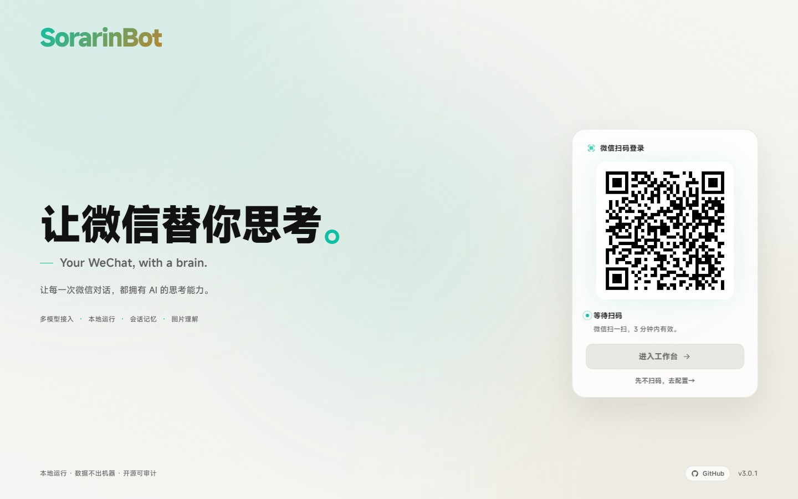
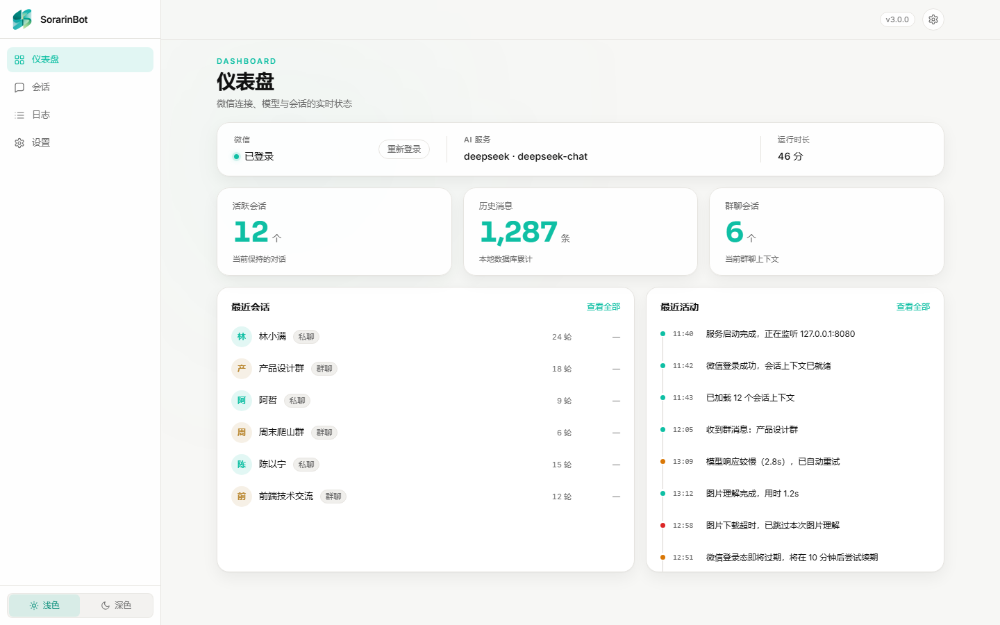
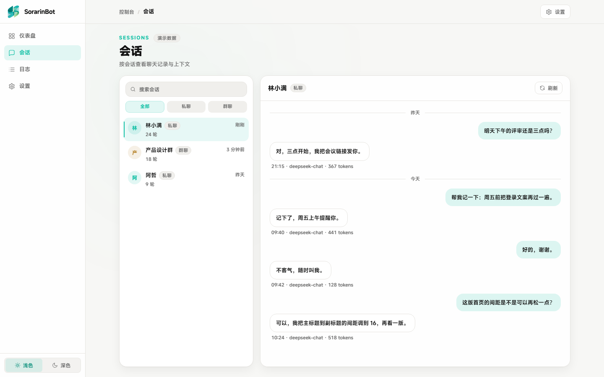
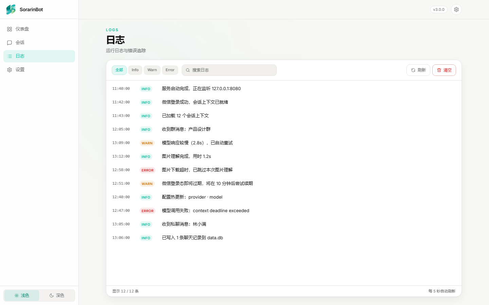
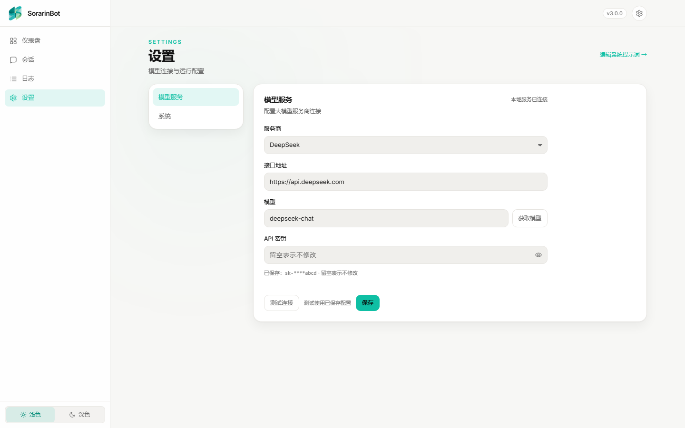
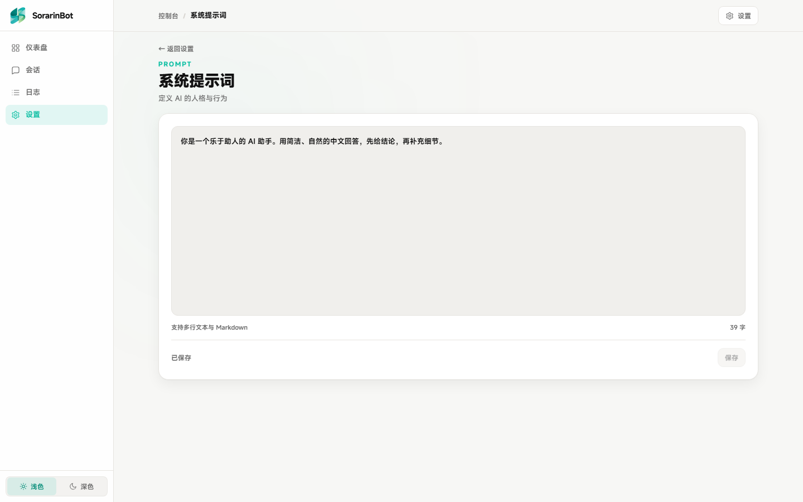
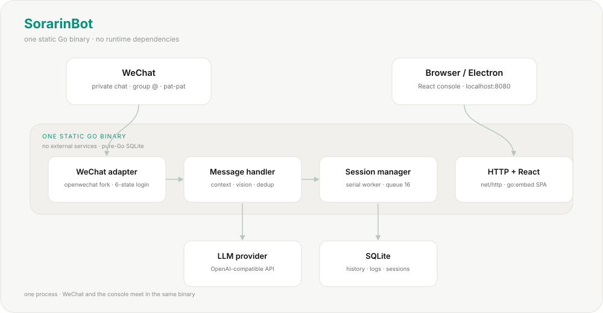

<p align="center">
  
</p>

<h1 align="center">SorarinBot</h1>

<p align="center">
  <strong>Your WeChat, wired to any LLM.</strong><br>
  A self-hosted AI assistant in a single Go binary — private-chat auto-reply,<br>
  group @mentions, vision, and memory isolated per conversation.
</p>

<p align="center">
  <a href="https://github.com/SorarinX/SorarinBot/releases/latest"></a>
  <a href="https://github.com/SorarinX/SorarinBot/actions/workflows/ci.yml"></a>
  <a href="LICENSE"></a>
  <a href="https://github.com/SorarinX/SorarinBot/releases"></a>
  <a href="https://github.com/SorarinX/SorarinBot/stargazers"></a>
</p>

<p align="center">
  <strong>English</strong> · <a href="./README.zh-CN.md">简体中文</a>
</p>

---

<p align="center">
  <a href="https://sorarinx.github.io/SorarinBot/"></a>
  <br>
  <sub>The welcome screen — scan the QR, or skip into the console and configure a model first.</sub>
</p>

> 🔗 **[Live preview](https://sorarinx.github.io/SorarinBot/)** — click through the dashboard with simulated data, no install required.
>
> 🆕 **v3.0.1** ships the Windows installer: a Tauri bootstrapper with a real rounded window, a four-step progress flow, and a manifest-driven payload. [Release notes →](https://github.com/SorarinX/SorarinBot/releases/tag/v3.0.1)

## 📑 Contents

- [Features](#-features)
- [Screenshots](#-screenshots)
- [Quick Start](#-quick-start)
- [Configuration](#-configuration)
- [CLI](#-cli)
- [Security](#-security)
- [Architecture](#-architecture)
- [API Reference](#-api-reference)
- [FAQ](#-faq)
- [Development](#-development)
- [Contributing](#-contributing)
- [License](#-license)

## ✨ Features

- 💬 **Private & group chat** — answers every private message, and in groups replies to `@mentions` or a configurable trigger prefix.
- 🤖 **Any OpenAI-compatible endpoint** — DeepSeek, MiniMax, OpenAI, Ollama, or a gateway in front of Claude / Gemini. Set `base_url` and `model`, nothing else.
- 🧠 **Memory isolated per conversation** — sessions are keyed by `private:<user>` and `group:<room>:<user>`, so the same person in two groups keeps two independent contexts.
- 🖼️ **Vision** — send an image with a caption and it is handed to a vision-capable model.
- 📊 **React console** — welcome/QR screen, dashboard, sessions, logs, settings, system prompt and login, with light and dark themes.
- 🏠 **Local-first** — one static binary, pure-Go SQLite, no external services. Your messages and keys stay on your machine.

<details>
<summary><b>Under the hood</b></summary>

- ⚡ **Non-blocking dispatch** — the WeChat sync loop only parses and enqueues; the model call runs on a per-session worker, so a slow provider cannot freeze every conversation.
- 🧵 **Strict, bounded sessions** — one serial worker per conversation keeps messages in order; a 16-deep queue drops with a warning instead of growing without limit; a panic in one conversation is contained.
- 🔐 **Observable login** — a six-state machine (`idle` → `hot_logging_in` → `waiting_scan` → `scanned` → `logged_in` / `failed`) surfaced in the dashboard with a **Retry** action. A failed login never takes the process down.
- 🔑 **Dashboard password** — optional, off by default, enforced on every API route when enabled; failed logins are throttled per address.
- 🖥️ **Friendly terminal** — startup card, QR block for headless machines, coloured logs; the console hides itself once the dashboard is up.
- 📌 **Tray & auto-start** — the Windows portable build adds a tray menu and a registry auto-start toggle.
- 🐧 **Linux** — the same root package cross-compiles for `linux/amd64`; see [LINUX.md](LINUX.md) for build and systemd instructions.
- 🎯 **Pat-pat** — WeChat "pat-pat" interactions get a random reply.

</details>

## 📸 Screenshots

<p align="center">
  
  <br>
  <sub>The dashboard — provider status, live WeChat login state and per-conversation sessions.</sub>
</p>

|                                         Chat history                                          |                                        System logs                                        |
| :------------------------------------------------------------------------------------------: | :---------------------------------------------------------------------------------------: |
|  |  |
| Sessions, date dividers and per-reply token usage. | Level filters, search and a live log stream. |

|                                       Settings                                        |                                     System prompt                                      |
| :----------------------------------------------------------------------------------: | :------------------------------------------------------------------------------------: |
|  |  |
| Provider presets, connection test and auto-start. | The system prompt that defines the bot's personality. |

## 🚀 Quick Start

> **Requirements** — Windows 10+ or Linux x64, roughly 25 MB of disk. Nothing else: the binary is statically linked, stores data with a pure-Go SQLite driver (no CGO), and carries the web UI inside it.

1. **Install or unzip.** Run `SorarinBot-Setup.exe` from [**Releases**](https://github.com/SorarinX/SorarinBot/releases) (recommended), or grab `SorarinBot-v*-win64-portable.zip` and extract it anywhere.
2. **Run it.** Double-click `SorarinBot.exe`. A tray icon appears, the dashboard opens at `http://localhost:8080`, and the console window hides itself after a moment. If 8080 is busy, the next free port is used and the browser is pointed at it.
3. **Connect a model.** Open **Settings**, paste an API key, pick a model, and save — the change applies to the next message, no restart. No key yet? Use **先不扫码，去配置** on the welcome screen to explore the console first.
4. **Log in to WeChat.** Scan the QR code on the welcome screen. On a headless machine, start with `-console-qr` to print the code in the terminal; `-console` keeps the console window visible. The status badge turns green once you are in.

Now send yourself a message on WeChat and the bot will answer.

> ⚠️ **Read [Security](#-security) before exposing the port.** The dashboard has no password out of the box, and the client speaks an unofficial WeChat protocol.

<details>
<summary><b>Other ways to run it</b> — Linux, desktop installer, build from source</summary>

### Linux

No Linux package is published for v3.0.1. Build it from source with the commands below, or follow [LINUX.md](LINUX.md) for a systemd setup.

### Windows — desktop installer

v3.0.1 publishes `SorarinBot-Setup.exe`, a Tauri bootstrapper that downloads the versioned Electron payload, verifies its SHA-256, installs per user, and launches the app.

> ⚠️ The installer is **unsigned** for now, so Windows SmartScreen may show "Unknown publisher". Code signing is the next release task. The portable build above stays available.

### Build from source

```bash
git clone https://github.com/SorarinX/SorarinBot.git
cd SorarinBot

# 1. Frontend — build the SPA into web/dist, where go:embed picks it up
cd web
npm install
npm run build
cd ..

# 2. Backend — Windows
go build -ldflags="-s -w" -o SorarinBot.exe .

# 2. Backend — Linux
GOOS=linux GOARCH=amd64 go build -ldflags="-s -w" -o SorarinBot .
```

Requires **Go 1.25+** and **Node.js 20+** with **npm**.

</details>

## ⚙️ Configuration

Everything lives in `config.yaml`, created next to the binary on first run. All of it can also be edited from the dashboard, and `data.db` / `token.json` are kept beside it — or in `%APPDATA%/SorarinBot` (Windows) and `~/.local/share/SorarinBot` (Linux) when the install directory is read-only.

```yaml
admin:
  password_hash: ""           # empty means no password; set it with SorarinBot -set-password

provider:
  name: deepseek              # deepseek | openai | minimax | openaicompat
  base_url: https://api.deepseek.com
  model: deepseek-chat
  api_key: ""

prompt: "你是一个乐于助人的 AI 助手。用简洁、自然的中文回答，先给结论，再补充细节。"

chat:
  max_context: 3              # previous turns replayed as context; 0 disables history
  image_ttl: 300              # seconds an uploaded image stays usable

wechat:
  auto_login: true            # reuse the saved token before asking for a QR scan
  trigger_prefix: ""          # extra group trigger, e.g. "/ai"

web:
  listen: localhost:8080
```

Keys worth knowing:

| Key | Default | Description |
| --- | --- | --- |
| `admin.password_hash` | – | Protects the dashboard. Empty means anyone who can reach the port gets in. Set it with `SorarinBot -set-password`. |
| `provider.name` | `openaicompat` | `deepseek`, `openai` and `minimax` fill in their default endpoint; `openaicompat` uses `base_url` verbatim. |
| `provider.base_url` | – | Base URL of the OpenAI-compatible API. A custom value is honoured for preset providers too (useful for proxies). |
| `provider.model` | – | Model name sent with every request. |
| `provider.api_key` | – | Falls back to `DEEPSEEK_API_KEY`, `MINIMAX_API_KEY` or `OPENAI_API_KEY` when left empty. |
| `prompt` | Chinese default | System prompt. The default is a concise Chinese assistant prompt. |
| `chat.max_context` | `3` | Previous user/assistant pairs replayed to the model. `0` turns memory off. |
| `chat.image_ttl` | `300` | Seconds an uploaded image stays eligible for the next message. |
| `wechat.auto_login` | `true` | Reuse `token.json` before falling back to a QR scan. Set to `false` to always scan, which is the way to replace a saved session. |
| `wechat.trigger_prefix` | – | A prefix that also triggers a group reply, in addition to `@mention`. |
| `web.listen` | `localhost:8080` | Dashboard address. Use `0.0.0.0:8080` to reach it from another machine. If the port is taken, the next free port is chosen at startup. |

## 🖥️ CLI

| Flag | What it does |
| --- | --- |
| `-set-password` | Prompt for a dashboard password, store its PBKDF2-SHA256 hash in `config.yaml`, and exit. An empty answer turns authentication off. |
| `-listen <addr>` | Override `web.listen` for a single run, e.g. `127.0.0.1:8081`. |
| `-console` | Keep the console window visible. By default it hides once the dashboard is reachable. |
| `-console-qr` | Print the WeChat login QR in the terminal instead of relying on the web UI (headless machines). |
| `-quiet` | Only print warnings and errors; no startup card, QR block or status lines. |

## 🔒 Security

- **There is no password until you set one.** With `admin.password_hash` empty, anyone who can reach the port can read chat history and logs and change your API key. Fine on `localhost`; not fine on a LAN.
- **The dashboard is plain HTTP.** The session cookie is not encrypted in transit. Put it behind a TLS reverse proxy before exposing it beyond your machine.
- **Your WeChat account is at risk.** This speaks the WeChat Web protocol through an unofficial client, against WeChat's terms of service. Use an account you can afford to lose.
- **Secrets on disk.** `config.yaml` holds your API key and `token.json` holds your WeChat session. Both are git-ignored; never paste either into an issue.

See [SECURITY.md](SECURITY.md) for the supported-version policy and how to report a vulnerability.

## 🏗️ Architecture

One process, no external services. WeChat and the dashboard meet inside the same Go binary; the only outbound call is the LLM request.

<p align="center">
  
</p>

Three ideas explain most of the design:

- **Dispatch is asynchronous.** The WeChat sync loop only parses and enqueues; the model call happens on a per-session worker, so a slow provider cannot freeze every conversation.
- **Sessions are strict and bounded.** One worker per conversation keeps it in order; a 16-deep queue drops with a warning instead of growing without limit; a panic in one conversation is contained.
- **Login is a state machine, not a loop.** A saved token is retried five times with backoff; otherwise the machine goes straight to a QR scan. It then parks in `failed` instead of exiting, and one click retries.

### Tech Stack

| Layer | Technology |
| --- | --- |
| Backend | Go 1.25 · `net/http` · `logrus` · `modernc.org/sqlite` (pure Go) |
| Frontend | React 19 · Vite 7 · Tailwind CSS 4 · TypeScript |
| Desktop | Electron 43 · electron-builder · Tauri 2 installer (unsigned as of v3.0.1) |
| Database | SQLite — `data.db`, chat history and system logs |
| WeChat | [openwechat](https://github.com/eatmoreapple/openwechat) v1.4.10, vendored under `internal/` |
| LLM | Any OpenAI-compatible HTTP API, via `providers/openaicompat` |

## 📡 API Reference

Every endpoint is served by the same binary as the dashboard. When `admin.password_hash` is set, everything except the three `auth` routes returns `401` until you sign in.

<details>
<summary><b>Endpoints</b></summary>

| Method | Endpoint | Description |
| --- | --- | --- |
| `GET` | `/api/auth/status` | Whether a password is required and whether this browser is signed in. Always public. |
| `POST` | `/api/auth/login` | Exchange a password for a session cookie. Always public. |
| `POST` | `/api/auth/logout` | Clear the session cookie. Always public. |
| `GET` | `/api/status` | Uptime, provider, model, `wechat_state` and the structured session list. |
| `GET` | `/api/login` | Login state machine snapshot — `state`, `attempts`, `qr_url`, `last_error`. |
| `POST` | `/api/login/retry` | Start a fresh login cycle (a new QR scan). Returns `202` when accepted. |
| `GET` | `/api/sessions` | Rendered session list. |
| `GET` | `/api/session?user=<key>` | Detail for one session. |
| `GET` | `/api/history?limit=50&offset=0` | Paginated chat history. |
| `GET` | `/api/logs?limit=100` | System logs. `DELETE` clears them. |
| `POST` | `/api/test` | Test the configured provider with a live request. |
| `GET` | `/api/models` | Models offered by the configured provider. |
| `GET` / `PUT` | `/api/config` | Read or update configuration (applied immediately). |
| `GET` / `PUT` | `/api/autostart` | Read or set the auto-start toggle. |

</details>

## ❓ FAQ

<details>
<summary><b>Windows says "Windows protected your PC"</b></summary>

The binary is not code-signed. Click **More info → Run anyway**. You can also verify the download against the release checksum.
</details>

<details>
<summary><b>Port 8080 is already in use</b></summary>

SorarinBot checks for a free port before printing the URL and opens the browser at the port it actually bound. If you need a fixed port, pass `-listen 127.0.0.1:8081`.
</details>

<details>
<summary><b>The QR code expired</b></summary>

A scan window lasts three minutes. When it expires the welcome screen shows **刷新二维码**; click it to request a new code. From the dashboard, the **重新登录** button does the same.
</details>

<details>
<summary><b>"Invalid API key" or the model does not answer</b></summary>

Open **Settings → 模型服务**, check the base URL and model, and use **测试连接** to see the provider's error. For DeepSeek the base URL is `https://api.deepseek.com` and a common model is `deepseek-chat`.
</details>

<details>
<summary><b>The console window disappeared</b></summary>

That is expected: it hides once the dashboard answers. Use the tray icon to reopen the dashboard or quit. Start with `-console` if you want to keep the window and its logs.
</details>

<details>
<summary><b>Can I use Claude or Gemini directly?</b></summary>

Only through an OpenAI-compatible gateway; the built-in client speaks the OpenAI chat-completions protocol. Point `base_url` at your gateway.
</details>

## 🛠️ Development

```bash
# Backend — run directly (the frontend must already be built into web/dist)
go run .

# Frontend — dev server with /api proxied to :8080
cd web && npm install && npm run dev

# Electron shell around a locally running backend
cd electron && npm install && npm start
```

**Debugging**

- Backend: set `SORARINBOT_DEBUG=1` for verbose logs.
- Electron main process: `console.log` lands in the terminal that started it.
- Renderer: call `mainWindow.webContents.openDevTools()` in `electron/main.js`.

**Tests** — CI runs `go vet ./...`, `go test ./...` and `gofmt -l .` on every push; the race detector is worth running locally too.

```bash
go vet ./...
go test ./... -race
gofmt -l .
```

## 🤝 Contributing

Issues, ideas and pull requests are all welcome. For anything larger than a bug fix, open an issue first so we can agree on the approach — and read [CONTRIBUTING.md](CONTRIBUTING.md) before you send a patch.

Release-by-release notes live in [CHANGELOG.md](CHANGELOG.md).

## ☕ Support

If SorarinBot is useful to you, a coffee is appreciated — it goes straight into API credits.

<p align="center">
  <a href="https://afdian.com/a/sorarinbot"></a>
  <br><br>
  
  <br>
  <sub>WeChat Pay · 微信支付</sub>
</p>

## 🙏 Acknowledgements

- [openwechat](https://github.com/eatmoreapple/openwechat) — the WeChat Web protocol this project builds on. A fork of it lives in `internal/openwechat/` under the Apache License 2.0; see [THIRD_PARTY_NOTICES.md](THIRD_PARTY_NOTICES.md) for exactly how it differs.
- [React](https://react.dev) and [Vite](https://vite.dev) — the dashboard runtime and build tool.
- [electron-builder](https://www.electron.build) — desktop packaging.
- And everyone who filed an issue or sent a pull request.

## 📄 License

SorarinBot is released under the [GNU Affero General Public License v3.0](LICENSE). You may use, modify, and redistribute it under AGPL-3.0. If you run a modified version as a network service, you must offer the corresponding source under the same license.
