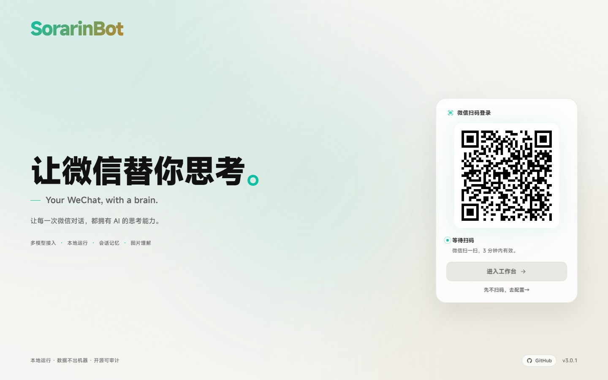
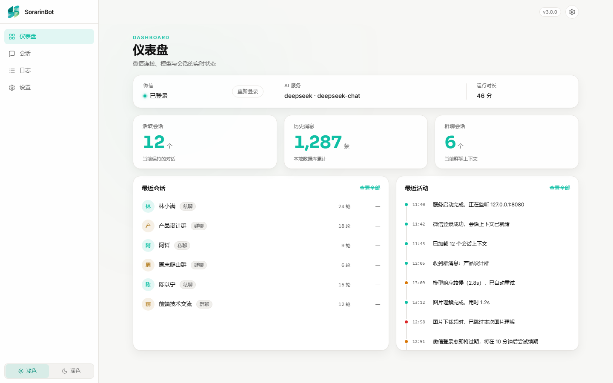
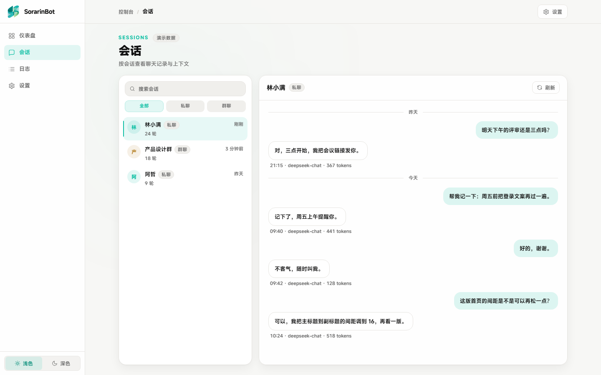
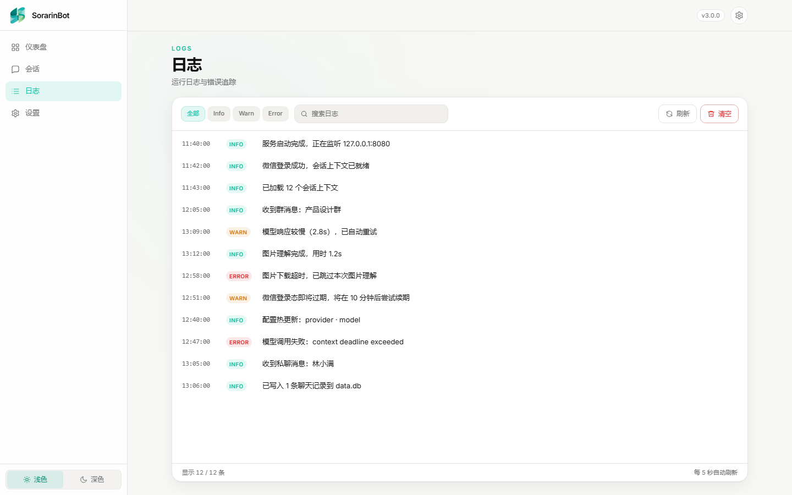
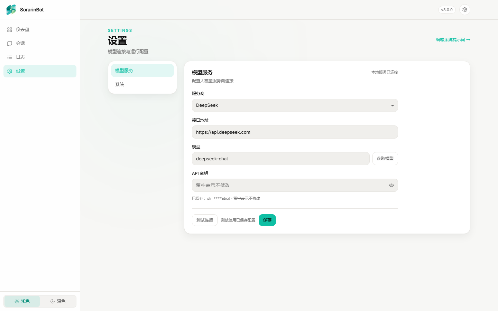
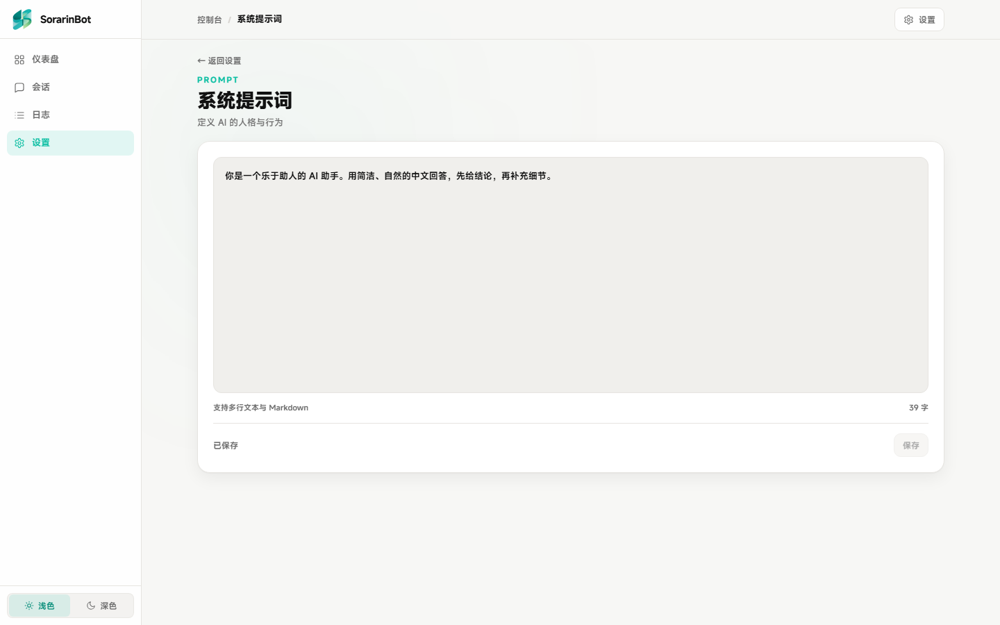
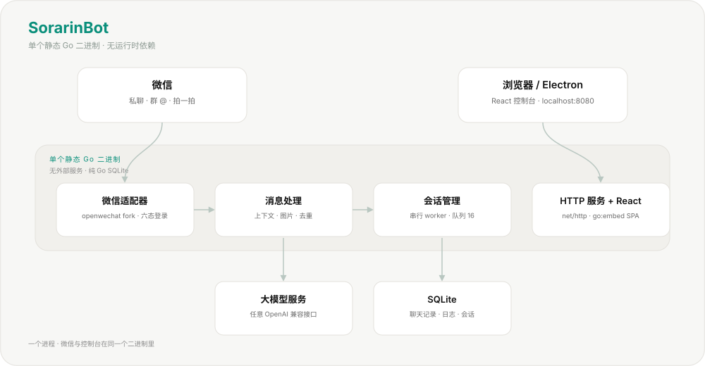

<p align="center">
  
</p>

<h1 align="center">SorarinBot</h1>

<p align="center">
  <strong>把你的微信，接入任意大模型。</strong><br>
  单文件 Go 二进制、自托管的 AI 助手 —— 私聊自动回复、群聊 @触发、<br>
  图片识别，并且每个会话拥有相互隔离的上下文记忆。
</p>

<p align="center">
  <a href="https://github.com/SorarinX/SorarinBot/releases/latest"></a>
  <a href="https://github.com/SorarinX/SorarinBot/actions/workflows/ci.yml"></a>
  <a href="LICENSE"></a>
  <a href="https://github.com/SorarinX/SorarinBot/releases"></a>
  <a href="https://github.com/SorarinX/SorarinBot/stargazers"></a>
</p>

<p align="center">
  <a href="./README.md">English</a> · <strong>简体中文</strong>
</p>

---

<p align="center">
  <a href="https://sorarinx.github.io/SorarinBot/"></a>
  <br>
  <sub>欢迎页 —— 扫码登录，或先跳过扫码进入控制台配置模型。</sub>
</p>

> 🔗 **[在线预览](https://sorarinx.github.io/SorarinBot/)** —— 用模拟数据完整体验控制台，无需安装。
>
> 🆕 **v3.0** 把 Nuxt 控制台换成 React 19 + Vite，新增明暗双主题欢迎页，并在后台就绪后自动隐藏控制台窗口。[发布说明 →](https://github.com/SorarinX/SorarinBot/releases/tag/v3.0.0)

## 📑 目录

- [功能特性](#-功能特性)
- [界面预览](#-界面预览)
- [快速开始](#-快速开始)
- [配置说明](#-配置说明)
- [命令行](#-命令行)
- [安全说明](#-安全说明)
- [项目架构](#-项目架构)
- [API 端点](#-api-端点)
- [常见问题](#-常见问题)
- [开发指南](#-开发指南)
- [参与贡献](#-参与贡献)
- [许可证](#-许可证)

## ✨ 功能特性

- 💬 **私聊与群聊** —— 私聊消息全部回复；群聊中回复 `@机器人`，或回复以自定义触发前缀开头的消息。
- 🤖 **任意 OpenAI 兼容接口** —— DeepSeek、MiniMax、OpenAI、Ollama，或 Claude / Gemini 前面的兼容网关。只需填 `base_url` 和 `model`。
- 🧠 **会话级隔离记忆** —— 会话以 `private:<用户>` 与 `group:<群ID>:<用户>` 为键，同一个人在不同群里拥有彼此独立的两份上下文。
- 🖼️ **图片识别** —— 发送图片 + 文字，自动交给支持 Vision 的模型。
- 📊 **React 控制台** —— 欢迎页 / 二维码、仪表盘、会话、日志、设置、系统提示词与登录页，支持明暗主题。
- 🏠 **本地优先** —— 一个静态二进制、纯 Go SQLite、无外部服务。消息和密钥都留在你自己的机器上。

<details>
<summary><b>实现细节</b></summary>

- ⚡ **异步分发** —— 微信同步循环只负责解析和入队；模型调用发生在会话自己的 worker 上，慢速 Provider 不会卡住所有对话。
- 🧵 **严格且有界的会话** —— 每个会话一个串行 worker，保证顺序；等待队列上限 16，超出时告警丢弃而不是无限增长；单个会话 panic 不会扩散。
- 🔐 **可观测的登录** —— 六态状态机（`idle` → `hot_logging_in` → `waiting_scan` → `scanned` → `logged_in` / `failed`），后台展示并提供重试；登录失败不会让进程退出。
- 🔑 **后台密码** —— 可选、默认关闭；启用后所有 API 路由都要求登录，失败尝试按来源地址限流。
- 🖥️ **友好的终端** —— 启动卡片、无头环境二维码、彩色日志；后台就绪后控制台自动隐藏。
- 📌 **系统托盘与开机自启** —— Windows 便携版提供托盘菜单和注册表自启动开关。
- 🐧 **Linux** —— 同一份根包可交叉编译 `linux/amd64`；`linux/` 目录是 2.1 时代的历史移植。
- 🎯 **拍一拍** —— 微信「拍一拍」会得到一句随机回复。

</details>

## 📸 界面预览

<p align="center">
  
  <br>
  <sub>仪表盘 —— Provider 状态、实时微信登录状态，以及按会话隔离的列表。</sub>
</p>

|                                        聊天记录                                        |                                        系统日志                                        |
| :-----------------------------------------------------------------------------------: | :------------------------------------------------------------------------------------: |
|  |  |
| 会话列表、日期分隔，以及每条回复的 token 用量。 | 级别筛选、搜索和实时日志流。 |

|                                       设置                                       |                                       系统提示词                                       |
| :-------------------------------------------------------------------------------: | :------------------------------------------------------------------------------------: |
|  |  |
| 服务商预设、连接测试和开机自启。 | 定义机器人性格的系统提示词。 |

## 🚀 快速开始

> **环境要求** —— Windows 10+ 或 Linux x64，约 25 MB 磁盘空间。除此之外不需要任何东西：二进制为静态链接，使用纯 Go 的 SQLite 驱动（无需 CGO），Web 界面已内嵌其中。

1. **下载。** 从 [**Releases**](https://github.com/SorarinX/SorarinBot/releases) 获取最新的 `SorarinBot-v*-win64-portable.zip`，解压到任意目录。
2. **运行。** 双击 `SorarinBot.exe`。托盘出现图标，浏览器自动打开 `http://localhost:8080`，控制台窗口随后自动隐藏。若 8080 被占用，会自动换到下一个空闲端口并打开正确地址。
3. **接入模型。** 打开 **设置**，填入 API Key、选择模型并保存 —— 下一条消息即生效，无需重启。还没有 Key？在欢迎页点 **先不扫码，去配置**，先逛逛控制台。
4. **登录微信。** 在欢迎页用微信扫描二维码。无头环境可加 `-console-qr` 在终端打印二维码；加 `-console` 可保留控制台窗口。状态标签变绿即表示登录成功。

现在用微信给自己发一条消息，机器人就会回复了。

> ⚠️ **开放端口之前先读[安全说明](#-安全说明)。** 后台开箱没有密码，而且本项目使用非官方微信协议。

<details>
<summary><b>其他运行方式</b> —— Linux、桌面安装包、从源码构建</summary>

### Linux

v3.0.0 不提供 Linux 发行包。请用下面的源码构建命令；`linux/` 目录是 2.1 时代的历史移植，不是当前版本。

### Windows —— 桌面安装包

v3.0.0 不附带 Electron 安装包。请使用上面的便携版，它包含同一套后端和 Web 控制台。

### 从源码构建

```bash
git clone https://github.com/SorarinX/SorarinBot.git
cd SorarinBot

# 1. 前端 —— 构建 SPA 到 web/dist，供 go:embed 打包
cd web
npm install
npm run build
cd ..

# 2. 后端 —— Windows
go build -ldflags="-s -w" -o SorarinBot.exe .

# 2. 后端 —— Linux
GOOS=linux GOARCH=amd64 go build -ldflags="-s -w" -o SorarinBot .
```

需要 **Go 1.25+** 与 **Node.js 20+**（含 **npm**）。

</details>

## ⚙️ 配置说明

所有配置都在首次运行时生成的 `config.yaml` 里，也可以在控制台里修改。`data.db` / `token.json` 与它放在一起 —— 如果安装目录只读，则放在 `%APPDATA%/SorarinBot`（Windows）或 `~/.local/share/SorarinBot`（Linux）。

```yaml
admin:
  password_hash: ""           # 留空表示不设密码；用 SorarinBot -set-password 设置

provider:
  name: deepseek              # deepseek | openai | minimax | openaicompat
  base_url: https://api.deepseek.com
  model: deepseek-chat
  api_key: ""

prompt: "你是一个乐于助人的 AI 助手。用简洁、自然的中文回答，先给结论，再补充细节。"

chat:
  max_context: 3              # 回放的历史轮数；0 表示关闭记忆
  image_ttl: 300              # 上传图片可用于下一条消息的秒数

wechat:
  auto_login: true            # 复用已保存的 token，失败再扫码
  trigger_prefix: ""          # 群聊额外触发前缀，例如 "/ai"

web:
  listen: localhost:8080
```

关键配置项：

| 配置 | 默认值 | 说明 |
| --- | --- | --- |
| `admin.password_hash` | – | 保护后台。留空表示任何能访问端口的人都能进入。用 `SorarinBot -set-password` 设置。 |
| `provider.name` | `openaicompat` | `deepseek`、`openai`、`minimax` 会自动填默认接口地址；`openaicompat` 完全按 `base_url` 请求。 |
| `provider.base_url` | – | OpenAI 兼容 API 的基础地址。预设服务商也支持自定义（适合代理/中转）。 |
| `provider.model` | – | 每次请求使用的模型名。 |
| `provider.api_key` | – | 留空时依次回退到 `DEEPSEEK_API_KEY`、`MINIMAX_API_KEY`、`OPENAI_API_KEY` 环境变量。 |
| `prompt` | 中文默认 | 系统提示词。默认是一段简洁的中文助手提示。 |
| `chat.max_context` | `3` | 回放的历史问答轮数；`0` 关闭记忆。 |
| `chat.image_ttl` | `300` | 上传图片可用于下一条消息的秒数。 |
| `wechat.auto_login` | `true` | 先复用 `token.json`，失败再扫码。设为 `false` 可强制重新扫码，用于更换账号。 |
| `wechat.trigger_prefix` | – | 除 `@机器人` 外，额外的群聊触发前缀。 |
| `web.listen` | `localhost:8080` | 控制台地址。用 `0.0.0.0:8080` 可从其他设备访问；端口被占用时启动阶段会自动选下一个空闲端口。 |

## 🖥️ 命令行

| 参数 | 作用 |
| --- | --- |
| `-set-password` | 交互式设置后台密码，把 PBKDF2-SHA256 哈希写入 `config.yaml` 后退出。输入留空即可关闭鉴权。 |
| `-listen <addr>` | 单次运行覆盖 `web.listen`，例如 `127.0.0.1:8081`。 |
| `-console` | 保留控制台窗口。默认在后台可访问后自动隐藏。 |
| `-console-qr` | 在终端打印微信登录二维码，而不是依赖 Web 界面（无头环境）。 |
| `-quiet` | 只输出警告和错误；不打印启动卡片、二维码和状态行。 |

## 🔒 安全说明

- **不设置密码就等于没有密码。** `admin.password_hash` 为空时，任何能访问该端口的人都能读取聊天记录和日志、修改 API Key。在 `localhost` 上没问题；在局域网上不行。
- **控制台走明文 HTTP。** 会话 Cookie 在传输中不加密。开放到本机之外前，请套一层带 TLS 的反向代理。
- **你的微信账号有风险。** 本项目通过非官方客户端使用微信 Web 协议，违反微信服务条款。请使用一个你能承受损失的账号。
- **磁盘上的敏感文件。** `config.yaml` 存着 API Key，`token.json` 存着微信登录态。两者都已 git 忽略；不要把内容贴进 Issue。

支持的版本与漏洞报告方式见 [SECURITY.md](SECURITY.md)。

## 🏗️ 项目架构

一个进程，无外部服务。微信和控制台在同一个 Go 二进制里相遇，唯一的对外请求是大模型调用。

<p align="center">
  
</p>

三个设计点解释了大部分结构：

- **分发是异步的。** 微信同步循环只解析和入队；模型调用在会话自己的 worker 上执行，慢速 Provider 不会冻结所有对话。
- **会话严格且有界。** 每个会话一个 worker 保证顺序；等待队列上限 16，超出时告警丢弃；单个会话 panic 被隔离。
- **登录是状态机，不是循环。** 有保存的 token 时最多重试 5 次（带退避）；没有 token 则直接进入扫码。失败后停在 `failed` 而不是退出，点一下即可重试。

### 技术栈

| 层次 | 技术 |
| --- | --- |
| 后端 | Go 1.25 · `net/http` · `logrus` · `modernc.org/sqlite`（纯 Go） |
| 前端 | React 19 · Vite 7 · Tailwind CSS 4 · TypeScript |
| 桌面端 | Electron 43 · electron-builder（v3.0.0 未发布） |
| 数据库 | SQLite —— `data.db`，保存聊天记录与系统日志 |
| 微信 | [openwechat](https://github.com/eatmoreapple/openwechat) v1.4.10，vendored 在 `internal/` 下 |
| 大模型 | 任意 OpenAI 兼容 HTTP 接口，由 `providers/openaicompat` 实现 |

## 📡 API 端点

所有接口都由与控制台相同的二进制提供。设置 `admin.password_hash` 后，除三个 `auth` 接口外，其余接口在登录前一律返回 `401`。

<details>
<summary><b>接口列表</b></summary>

| 方法 | 端点 | 说明 |
| --- | --- | --- |
| `GET` | `/api/auth/status` | 是否需要密码，以及当前浏览器是否已登录。始终公开。 |
| `POST` | `/api/auth/login` | 用密码换取会话 Cookie。始终公开。 |
| `POST` | `/api/auth/logout` | 清除会话 Cookie。始终公开。 |
| `GET` | `/api/status` | 运行时长、Provider、模型、`wechat_state` 以及结构化会话列表。 |
| `GET` | `/api/login` | 登录状态机快照 —— `state`、`attempts`、`qr_url`、`last_error`。 |
| `POST` | `/api/login/retry` | 开启新一轮登录（重新扫码）。接受时返回 `202`。 |
| `GET` | `/api/sessions` | 渲染后的会话列表。 |
| `GET` | `/api/session?user=<key>` | 单个会话详情。 |
| `GET` | `/api/history?limit=50&offset=0` | 分页聊天记录。 |
| `GET` | `/api/logs?limit=100` | 系统日志；`DELETE` 清空。 |
| `POST` | `/api/test` | 用一次真实请求测试当前 Provider。 |
| `GET` | `/api/models` | 当前 Provider 可用的模型列表。 |
| `GET` / `PUT` | `/api/config` | 读取或更新配置（立即生效）。 |
| `GET` / `PUT` | `/api/autostart` | 读取或设置开机自启。 |

</details>

## ❓ 常见问题

<details>
<summary><b>Windows 提示「已保护你的电脑」</b></summary>

二进制没有代码签名。点 **更多信息 → 仍要运行**。也可以用 Release 里的校验和核对下载文件。
</details>

<details>
<summary><b>8080 端口被占用</b></summary>

SorarinBot 在打印地址前会先找空闲端口，并按实际绑定的端口打开浏览器。如果需要固定端口，加 `-listen 127.0.0.1:8081`。
</details>

<details>
<summary><b>二维码过期了</b></summary>

扫码窗口是 3 分钟。过期后欢迎页会显示 **刷新二维码**，点一下即可重新获取。仪表盘里的 **重新登录** 按钮效果相同。
</details>

<details>
<summary><b>提示 API Key 无效 / 模型不回复</b></summary>

打开 **设置 → 模型服务**，检查接口地址和模型，点 **测试连接** 查看 Provider 返回的错误。DeepSeek 的接口地址是 `https://api.deepseek.com`，常用模型是 `deepseek-chat`。
</details>

<details>
<summary><b>控制台窗口消失了</b></summary>

这是正常的：后台可访问后它会自动隐藏。用托盘图标可以重新打开控制台或退出。想保留窗口和日志，启动时加 `-console`。
</details>

<details>
<summary><b>能直接接 Claude / Gemini 吗？</b></summary>

只能通过 OpenAI 兼容网关；内置客户端使用 OpenAI chat-completions 协议。把 `base_url` 指向你的网关即可。
</details>

## 🛠️ 开发指南

```bash
# 后端 —— 直接运行（前端需已构建到 web/dist）
go run .

# 前端 —— 开发服务器，/api 代理到 :8080
cd web && npm install && npm run dev

# Electron 壳，连接本地已启动的后端
cd electron && npm install && npm start
```

> 请构建根包 —— `go build .` —— 而不是 `go build ./...`。`linux/` 是根目录文件的历史副本：它的 `main.go` 带 `//go:build ignore`，其余文件没有 `main`，递归构建会报 `function main is undeclared`。

**调试**

- 后端：设置 `SORARINBOT_DEBUG=1` 输出详细日志。
- Electron 主进程：`console.log` 会输出到启动它的终端。
- 渲染进程：在 `electron/main.js` 中调用 `mainWindow.webContents.openDevTools()`。

**测试** —— CI 每次推送都会执行 `go vet ./...`、`go test ./...` 和 `gofmt -l .`；建议本地额外跑一次 `-race`。

```bash
go vet ./...
go test ./... -race
gofmt -l .
```

## 🤝 参与贡献

欢迎 Issue、想法和 Pull Request。大于 bug 修复的改动，请先开 Issue 对齐方案，并在提交前读一遍 [CONTRIBUTING.md](CONTRIBUTING.md)。

逐版本变更记录在 [CHANGELOG.md](CHANGELOG.md)。

## ☕ 支持作者

如果 SorarinBot 对你有帮助，欢迎请作者喝杯咖啡 —— 会直接变成 API 额度。

<p align="center">
  <a href="https://afdian.com/a/sorarinbot"></a>
  <br><br>
  
  <br>
  <sub>WeChat Pay · 微信支付</sub>
</p>

## 🙏 致谢

- [openwechat](https://github.com/eatmoreapple/openwechat) —— 本项目所基于的微信 Web 协议，fork 位于 `internal/openwechat/`，适用 Apache License 2.0；具体差异见 [THIRD_PARTY_NOTICES.md](THIRD_PARTY_NOTICES.md)。
- [React](https://react.dev) 与 [Vite](https://vite.dev) —— 控制台的运行时与构建工具。
- [electron-builder](https://www.electron.build) —— 桌面打包。
- 以及每一位提交 Issue 或 Pull Request 的人。

## 📄 许可证

SorarinBot 基于 [PolyForm Noncommercial License 1.0.0](LICENSE) 发布 —— 个人学习、教育、研究、公益机构与政府部门均可免费使用。

**商业用途需另行取得授权。** 请联系 **zyc2597376118@gmail.com**。
